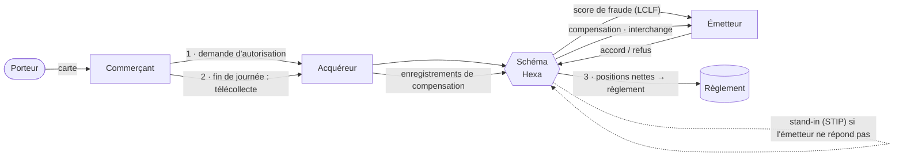

# Analyst Kit · Compétences IA pour le métier des paiements et des API

**Dix-huit compétences IA qui font le travail d'un Business Analyst / Product Owner dans la monétique et les API, sous forme de modèles automatisés dans une application locale, en français et en anglais.**

🇬🇧 [English version](README.md)

J'ai travaillé dans un réseau de paiement par carte français, un schéma domestique comparable à Visa ou Mastercard. Le métier se situe entre les **émetteurs**, les **acquéreurs** et les plateformes du schéma : **autorisation** en temps réel, **compensation** et **règlement**, **commission d'interchange**, **LCLF** (lutte contre la fraude), impayés, et les API membres qui relient le tout.

Le travail suit toujours la même boucle : animer un atelier avec les banques membres, rédiger la spec, tester l'API, planifier la release, piloter la recette, mesurer l'impact de la prochaine règle. Et chaque fois, il est fait trois fois : on le **fait** dans un outil, on le **documente**, puis on l'**automatise** pour la fois suivante.

Ce dépôt le fait une seule fois. Chaque compétence contient la méthode (structure de SFD, WSJF, critères de sortie, dimensions de qualité des données, BPMN, Gherkin…) et l'application la transforme en **modèle** : on choisit un livrable, on remplit le modèle ou on colle ses notes, et Claude produit le document ainsi que les fichiers que vos outils importent (CSV Jira, Xray, SQL, `.bpmn`, pytest).

---

## L'écosystème des exemples

Tous les exemples se passent chez **Hexa**, un schéma de cartes domestique fictif avec 22 émetteurs et 9 acquéreurs.



| Terme | En anglais | En une ligne |
|---|---|---|
| Émetteur | Issuer | La banque du porteur : accorde ou refuse, reçoit l'interchange |
| Acquéreur | Acquirer | La banque du commerçant : achemine autorisations et compensation, paie l'interchange |
| Autorisation | Authorisation | Demande en temps réel au moment de l'achat ; le schéma décide en **stand-in** si l'émetteur ne répond pas |
| Compensation | Clearing | Échange différé des opérations, rapprochées des autorisations, calcul de l'interchange |
| Règlement | Settlement | Mouvement des fonds entre membres à partir des positions nettes |
| Commission d'interchange | Interchange fee | Payée par l'acquéreur à l'émetteur, plafonnée par le règlement européen IFR pour les cartes de particuliers |
| LCLF | Fraud prevention | Scores, règles de refus, 3-D Secure, déclarations de fraude des émetteurs |
| Impayé / litige | Chargeback / dispute | Contestation par l'émetteur, représentation par l'acquéreur, puis arbitrage |

## Un projet de bout en bout : un score de fraude en temps réel dans l'autorisation

Les exemples suivent un seul projet, comme il se déroule dans un schéma : le schéma note chaque autorisation avec ce que lui seul voit (le trafic de tous les émetteurs) et envoie le score à l'émetteur, qui garde la décision.

| Étape | Compétence | Exemple |
|---|---|---|
| 1 · Cadrer | PRD | [Score de fraude en temps réel](app/seed/3-prd.md) : fraude CNP de 0,11 % à 0,17 %, objectifs, garde-fous (taux d'autorisation, 15 ms) |
| 2 · Atelier avec les émetteurs pilotes | Atelier & compte-rendu | [Notes → compte-rendu](app/seed/16-workshop.md) : décisions, exigences numérotées, question juridique ouverte |
| 3 · Spécifier | Spécification SFD | [Le score dans la demande d'autorisation](app/seed/17-sfd.md) : 8 règles de gestion, champ RS, stand-in, compensation |
| 4 · User stories | User stories | [Paramètres fraude des émetteurs dans le portail membres](app/seed/5-stories.md) : double validation, activation de nuit, Gherkin |
| 5 · Planifier le PI | Backlog & PI planning | [Classement WSJF et objectifs de PI](app/seed/21-backlog.md), avec un fichier d'import Jira · [`wsjf.py`](skills/managing-backlog/scripts/wsjf.py) |
| 6 · Piloter la recette | Campagne de recette | [Tableau de bord J8 avec les émetteurs pilotes](app/seed/18-uat.md) : statut rouge, tri des anomalies · [`uat_report.py`](skills/running-uat/scripts/uat_report.py) |

Autour, le reste du travail d'un schéma :

| Travail | Compétence | Exemple |
|---|---|---|
| Le parcours d'un paiement carte | Processus (BPMN) | [Autorisation, compensation, règlement](app/seed/1-process.md) en BPMN 2.0, quatre couloirs |
| API membres | Plan de test API | [API litiges (impayés)](app/seed/2-api.md) : 7 règles, 19 cas, pytest, mTLS |
| Réglementation / règle du schéma | Analyse d'impact | [Nouvelle grille d'interchange domestique](app/seed/19-impact.md) : plafonds IFR, impacts sur la compensation, la facturation et les membres |
| Migration | Mapping de données | [Fichier de compensation acquéreur → API](app/seed/20-mapping.md) : mapping, transcodages, qualité, SQL de rapprochement avec les autorisations · [`check_mapping.py`](skills/mapping-data/scripts/check_mapping.py) |
| Contrôle financier | Requête SQL | [Interchange facturée vs attendue par acquéreur](app/seed/4-sql.md) |
| Analyse de fraude | Requête SQL | [Rafales de refus suspectes](app/seed/13-sql-fraud.md) |

## Les compétences

| Phase | Compétences |
|---|---|
| **Cadrer** | [Atelier & compte-rendu](skills/facilitating-workshops/SKILL.md) · [Analyse d'écart & d'impact](skills/analysing-gaps-and-impacts/SKILL.md) · [Processus BPMN](skills/modeling-processes/SKILL.md) · [PRD](skills/writing-prds/SKILL.md) |
| **Spécifier** | [Spécification SFG / SFD](skills/writing-functional-specs/SKILL.md) · [User stories](skills/writing-user-stories/SKILL.md) · [Plan de test API](skills/testing-apis/SKILL.md) · [Mapping de données](skills/mapping-data/SKILL.md) · [Requête SQL](skills/generating-sql/SKILL.md) |
| **Planifier, tester, livrer** | [Backlog & PI planning](skills/managing-backlog/SKILL.md) · [Campagne de recette](skills/running-uat/SKILL.md) · [Tests Xray](skills/managing-xray-tests/SKILL.md) (Cloud et Server / Data Center) · [Pilotage & alignement](skills/aligning-stakeholders/SKILL.md) |
| **IA conversationnelle** | [Roadmap cas d'usage IA](skills/prioritizing-ai-use-cases/SKILL.md) · [Design conversationnel](skills/designing-conversational-journeys/SKILL.md) · [Évaluation RAG](skills/evaluating-rag-quality/SKILL.md) · [Risques IA & garde-fous](skills/governing-ai-risk/SKILL.md) · [Base de connaissances](skills/curating-knowledge-bases/SKILL.md), avec l'[étude de cas bancaire](examples/banking-ai-support/README.md) |

## Analyst Kit : l'application

- **Un modèle par livrable.** *Utiliser le modèle* remplit la zone de notes avec ce dont la compétence a besoin, dans l'ordre. Vous remplissez ce que vous savez, Claude demande le reste.
- **Français et anglais.** Le bouton **FR / EN** traduit toute l'interface, les modèles et le Guide. Les documents sont rédigés dans la langue choisie dans le profil.
- **Classée par phase :** cadrer, spécifier, planifier / tester / livrer, IA conversationnelle.
- **Essayer avant d'écrire.** Un exemple terminé par compétence et trois scénarios réalistes chacune (litiges, interchange, migration de la compensation, référentiel BIN…).
- **Des fichiers importables.** CSV Jira, CSV / `.feature` / JSON Xray, SQL, pytest, `.bpmn`, avec Copier et Télécharger.
- **Guide et assistant Xray intégrés**, dans les deux langues : compétences, vocabulaire (interchange, stand-in, WSJF, PV de recette…) et application.
- **Une conversation à côté de chaque document**, toutes les versions conservées, export Word ou PDF.

```bash
python3 app/server.py      # puis ouvrir http://localhost:4317
```

## Ce que demande le marché

Les six compétences de delivery ajoutées en dernier viennent d'une [analyse de 740 missions freelance BA / PO en Île-de-France](market/README.md) (Free-Work, septembre–octobre 2026) : ateliers dans 68 % des annonces, recette 57 %, spécifications 52 %. Le rapport liste aussi les outils à maîtriser et les TJM.

Les organisations, membres et chiffres sont fictifs. Les règles du schéma (délais, codes motif, champs de message) sont inventées pour les exemples. Les points réglementaires sont des synthèses, à valider avec les équipes juridique et conformité.
