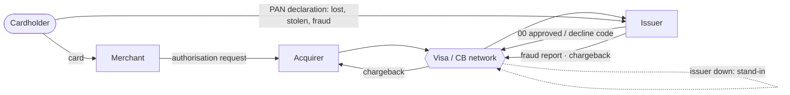

# Analyst Kit · AI skills for card payments & API product work

**Eighteen AI skills that do the work of a Business Analyst / Product Owner in card payments, in a local app where every deliverable starts from a few precise questions and your own documents. Samples in English follow Visa rules; samples in French follow CB (Cartes Bancaires) rules.**

[](https://mohoss1985-tech.github.io/AI-skills/)

**[Live demo](https://mohoss1985-tech.github.io/AI-skills/)**: browse every skill and finished sample in your browser, in English (Visa) or French (CB). Read-only: generating your own deliverables runs locally with Claude Code.

🇫🇷 [Version française](README.fr.md)

I worked at a French card payment network. The work sits between **issuers** (émetteurs), **acquirers** (acquéreurs) and the network: card **authorisation**, **PAN declaration** (blocking a lost or stolen card, declaring fraud), **chargebacks** (impayés), interchange, clearing and settlement, and the APIs between them.

The work is always the same loop: run a workshop, write the spec, test the API, plan the release, run the UAT, measure the impact of the next rule change. Each time it happens three times: **do it** in a tool, **document** it, then **automate** it for next time.

This repository does it once. Each skill holds the method (SFD structure, WSJF, exit criteria, data quality dimensions, BPMN, Gherkin…). The app turns it into a guided form: answer a few short questions, drop your documents, and Claude produces the deliverable plus the files your tools import (Jira CSV, Xray, SQL, `.bpmn`, pytest).

---

## Three use cases, two schemes

| Use case | English samples: **Visa** (Harbor Bank, an issuer) | French samples: **CB** (Banque Lumière, émetteur CB) |
|---|---|---|
| **Authorisation** | VisaNet, issuer decision, **Stand-In Processing**, Exception File, response codes (00, 51, 54, 41, 43, 59, 1A) | Network CB, issuer authorisation server, fallback processing, CB2A response codes (00, 51, 54, 41, 43, 59, 91) |
| **PAN declaration** | Block a lost / stolen card, list the PAN on the **Visa Exception File**, suspend wallet tokens, **report the fraud to Visa** | **Mise en opposition**, unauthorised transactions refunded by the end of the next business day (CMF art. L133-18), **déclaration de fraude au GIE CB** |
| **Chargebacks** | **Visa dispute conditions** (10 fraud, 11 authorisation, 12 processing errors, 13 consumer disputes), fraud reported before a fraud dispute | **Impayés CB**, cardholder contestation within 13 months (CMF art. L133-24), fraud declared before the impayé |



The English samples use **Visa** terms and the French samples use **CB** terms. The interface shows the samples of its language. Scheme figures that only the scheme rulebook can confirm (fraud type codes, reporting deadlines, CB reason codes) are marked *to confirm* in the samples.

## The project behind the samples: declaring a lost or stolen card

| Step | Skill | English (Visa) | French (CB) |
|---|---|---|---|
| Frame | PRD | [Declare a lost or stolen card in the app](app/seed/3-prd.md) | [Mise en opposition dans l'appli](app/seed/103-prd.md) |
| Workshop | Workshop & report | [Notes → report](app/seed/16-workshop.md) | [Notes → compte-rendu](app/seed/116-workshop.md) |
| Specify | Functional spec (SFD) | [Block, Exception File, fraud report](app/seed/17-sfd.md) | [Opposition, remboursement, déclaration](app/seed/117-sfd.md) |
| Stories | User stories | [Block a card, flag unknown payments](app/seed/5-stories.md) | [Opposition et contestation](app/seed/105-stories.md) |
| Plan | Backlog & PI planning | [WSJF, PI objectives, Jira CSV](app/seed/21-backlog.md) | [WSJF, objectifs de PI](app/seed/121-backlog.md) |
| Test | UAT campaign | [Day 8 dashboard](app/seed/18-uat.md) | [Recette J8](app/seed/118-uat.md) |
| Report fraud | Data mapping | [Fraud cases → Visa fraud reports](app/seed/20-mapping.md) | [Dossiers → déclarations GIE CB](app/seed/120-mapping.md) |

And around it:

| Work | Skill | English (Visa) | French (CB) |
|---|---|---|---|
| Authorisation flow | Process map | [Visa authorisation with stand-in](app/seed/1-process.md) (BPMN) | [Autorisation CB avec secours](app/seed/101-process.md) (BPMN) |
| Authorisation analytics | SQL query | [Approval rate and top decline codes](app/seed/4-sql.md) | [Taux d'acceptation et codes de refus](app/seed/104-sql.md) |
| Chargebacks API | API test plan | [Disputes API (Visa conditions)](app/seed/2-api.md) | [API impayés](app/seed/102-api.md) |
| Chargebacks process | Gap & impact analysis | [Chargebacks out of spreadsheets](app/seed/19-impact.md) | [Contestations et impayés hors Excel](app/seed/119-impact.md) |

The figures come from the skills' scripts ([`uat_report.py`](skills/running-uat/scripts/uat_report.py), [`wsjf.py`](skills/managing-backlog/scripts/wsjf.py), [`check_mapping.py`](skills/mapping-data/scripts/check_mapping.py), [`build_bpmn.py`](skills/modeling-processes/scripts/build_bpmn.py)), and the SQL was run on test data.

## How a deliverable is made

1. **Pick a deliverable** (grouped by phase: frame, specify, plan / test / deliver, conversational AI).
2. **Answer the quick questions:** 3 to 6 short, precise inputs per skill. Examples: which scheme rules, which phase of the UAT, which flow type for a mapping. Required ones are marked *.
3. **Drop your documents:** PDF, Word, Excel, PowerPoint, CSV, PNG or JPEG. They are the **privileged source**: Claude reads them first, bases facts and figures on them, names the file each one comes from, and flags where your notes disagree with them. Word, Excel and PowerPoint text is extracted locally.
4. **Add skill knowledge once:** on each skill page, documents reused by every deliverable of that type (scheme rulebook, internal procedures, templates).
5. **Get the deliverable**, discuss it in the conversation next to it, add a newer document later to update it, export to Word or PDF.

## The skills

### Discover & frame
| Skill | You get |
|---|---|
| [**Workshop & report**](skills/facilitating-workshops/SKILL.md) | Workshop plan, or a report with decisions, numbered requirements, business rules, open questions and actions |
| [**Gap & impact analysis**](skills/analysing-gaps-and-impacts/SKILL.md) | Existing vs target, regulatory traceability, impact matrix with sizes and owners, transition plan |
| [**Process map**](skills/modeling-processes/SKILL.md) | Colour-coded BPMN 2.0 with swimlanes, steps traced to the source, open questions |
| [**PRD**](skills/writing-prds/SKILL.md) | One-pager or full PRD with evidence, goals, guardrail metrics, traceable requirements |

### Specify & build
| Skill | You get |
|---|---|
| [**Functional spec (SFG / SFD)**](skills/writing-functional-specs/SKILL.md) | Business rules, screens, messages, interfaces, NFRs, traceability, test ideas; or a review of a spec |
| [**User stories**](skills/writing-user-stories/SKILL.md) | Sprint-ready stories, Gherkin (English or French keywords), INVEST check |
| [**API test plan**](skills/testing-apis/SKILL.md) | Test matrix tied to business rules, runnable pytest, reference docs |
| [**Data mapping**](skills/mapping-data/SKILL.md) | Data dictionary, mapping, code tables, data quality rules, reconciliation SQL |
| [**SQL query**](skills/generating-sql/SKILL.md) | Readable SQL, plain-language walkthrough, validation queries |

### Plan, test & deliver
| Skill | You get |
|---|---|
| [**Backlog & PI planning**](skills/managing-backlog/SKILL.md) | WSJF ranking, a plan that fits the capacity (dependencies pulled forward), PI objectives, ROAM, Jira CSV |
| [**UAT campaign**](skills/running-uat/SKILL.md) | Strategy, exit criteria, daily dashboard from Jira / Xray / Squash / HP ALM exports, triage, go / no-go, sign-off |
| [**Xray tests**](skills/managing-xray-tests/SKILL.md) | Manual, Cucumber and Generic tests with coverage, import files for Xray Cloud and Server / Data Center |
| [**Steering & alignment**](skills/aligning-stakeholders/SKILL.md) | Decision memo, steering update, RACI, release notes, change plan |

### Conversational AI & RAG
[AI use-case roadmap](skills/prioritizing-ai-use-cases/SKILL.md) · [Conversation design](skills/designing-conversational-journeys/SKILL.md) · [RAG evaluation](skills/evaluating-rag-quality/SKILL.md) · [AI risk & guardrails](skills/governing-ai-risk/SKILL.md) · [Knowledge base curation](skills/curating-knowledge-bases/SKILL.md), with a [banking assistant case study](examples/banking-ai-support/README.md).

## Analyst Kit: the app

```bash
python3 app/server.py      # then open http://localhost:4317
```

- **Quick questions and documents** on every deliverable, plus a reusable **knowledge** folder per skill.
- **English and French:** the **FR / EN** switch translates the interface, the questions and the Guide, and shows the Visa or CB samples and scenarios.
- **A finished sample and two scenarios per skill**, in each language.
- **Files your tools import**, each with Copy and Download.
- **Guide and Xray assistant:** instant answers on the skills, the jargon (stand-in, Exception File, opposition, response codes, WSJF…) and the app.
- **No API key:** requests wait in a local queue; Claude, in a Claude Code session, picks them up with [`app/kit.py`](app/kit.py), which lists the answers and the documents to read first.

## What the market asks for

The six delivery skills come from [an analysis of 740 freelance BA / PO contracts in Île-de-France](market/README.md) (Free-Work, Sept–Oct 2026). The report covers the most requested tasks (workshops 68%, acceptance testing 57%, functional specs 52%), the tools to master, and day rates.

## Repository layout

```
skills/     eighteen skills, one SKILL.md each (+ scripts/, templates/, examples/)
app/        server.py, kit.py, questions.py, sources.py (uploads), i18n_fr.py, static/, seed/ samples (1–21 English, 101–121 French)
examples/   conversational AI case study
market/     freelance market analysis and method
```

## More from my AI portfolio

| Project | What it is |
|---|---|
| [**Fitbit Air on Steroids (MRH1)**](https://github.com/mohoss1985-tech/fitbit-air-on-steroids) · [live demo](https://mohoss1985-tech.github.io/fitbit-air-on-steroids/demo/) | A custom iOS app (SwiftUI + HealthKit) for the Google Fitbit Air: Whoop-style scores, lab-style body panels and every health metric explained. Built with Claude. |

All organisations and figures are fictional. Scheme rules are paraphrased for the samples; confirm codes and deadlines against the current Visa Core Rules or CB rules, and legal points with your legal and compliance teams.
