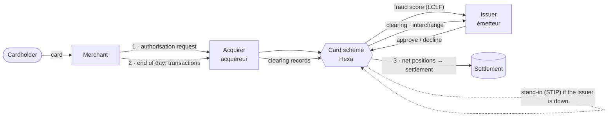
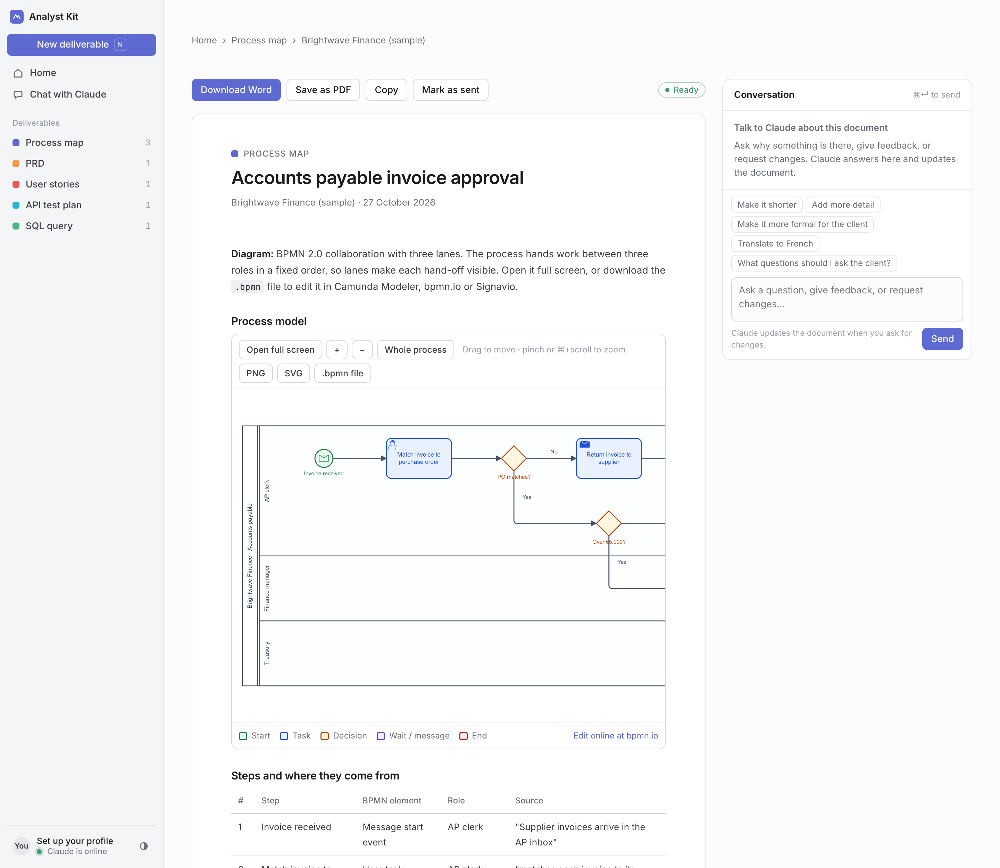

# Analyst Kit · AI skills for payments & API product work

**Eighteen AI skills that do the work of a Business Analyst / Product Owner in card payments and APIs, packaged as automated templates in a local app, in English and French.**

🇫🇷 [Version française](README.fr.md)

I worked at a French card payment network, a domestic scheme similar to Visa or Mastercard. The job sits between **issuers** (émetteurs), **acquirers** (acquéreurs) and the scheme's own platforms: real-time **authorisation**, **clearing** (compensation) and **settlement** (règlement), **interchange**, fraud prevention (**LCLF**, *lutte contre la fraude*), disputes, and the member APIs that connect it all.

The work is always the same loop: run a workshop with member banks, write the spec, test the API, plan the release, run the UAT, measure the impact of the next rule change. And every time it happens three times: **do it** in a tool, **document** it, then **automate** it for the next time.

This repository does it once. Each skill holds the method (SFD structure, WSJF, exit criteria, data quality dimensions, BPMN, Gherkin…) and the app turns it into a **template**: pick a deliverable, fill the template or paste your notes, and Claude produces the document plus the files your tools import (Jira CSV, Xray, SQL, `.bpmn`, pytest).

---

## The payments ecosystem the samples use

Every sample is set at **Hexa**, a fictional domestic card scheme with 22 issuers and 9 acquirers.



| Term | Français | In one line |
|---|---|---|
| Issuer | Émetteur | The cardholder's bank: approves or declines, receives the interchange |
| Acquirer | Acquéreur | The merchant's bank: routes authorisations and clearing, pays the interchange |
| Authorisation | Autorisation | Real-time request at checkout; the scheme decides in **stand-in** if the issuer doesn't answer |
| Clearing | Compensation | Batch exchange of transaction records, matched to authorisations, interchange computed |
| Settlement | Règlement | Funds move between members from the net positions |
| Interchange | Commission d'interchange | Fee from acquirer to issuer per transaction, capped by the EU IFR for consumer cards |
| Fraud prevention | LCLF | Scores, decline rules, 3-D Secure, issuers' fraud reports |
| Dispute | Impayé / litige | Chargeback by the issuer, representment by the acquirer, then arbitration |

## One project, end to end: a real-time fraud score in authorisation

The samples follow a single project, the way it runs in a scheme: the scheme scores every authorisation with what only it can see (traffic across all issuers) and sends the score to the issuer, who keeps the decision.

| Step | Skill | Sample |
|---|---|---|
| 1 · Frame the problem | PRD | [Real-time fraud score in authorisation](app/seed/3-prd.md): CNP fraud up from 0.11% to 0.17%, goals, guardrails (approval rate, 15 ms latency) |
| 2 · Workshop with pilot issuers | Workshop & report | [Meeting notes → report](app/seed/16-workshop.md): decisions, numbered requirements, open legal question on cross-issuer data |
| 3 · Specify | Functional spec (SFD) | [Fraud score in the authorisation request](app/seed/17-sfd.md): 8 business rules, message field RS, stand-in, clearing, Legal conditions |
| 4 · Stories | User stories | [Issuer fraud-score settings in the member portal](app/seed/5-stories.md): 4-eyes approval, nightly activation, Gherkin |
| 5 · Plan the PI | Backlog & PI planning | [WSJF ranking and PI objectives](app/seed/21-backlog.md), with a Jira import file · [`wsjf.py`](skills/managing-backlog/scripts/wsjf.py) |
| 6 · Run the UAT | UAT campaign | [Day 8 dashboard with pilot issuers](app/seed/18-uat.md): stand-in ignores the threshold, score leaks to acquirers → red · [`uat_report.py`](skills/running-uat/scripts/uat_report.py) |

Around it, the rest of the scheme's work:

| Work | Skill | Sample |
|---|---|---|
| How a card payment flows | Process map | [Authorisation, clearing, settlement](app/seed/1-process.md) as BPMN 2.0, four lanes |
| Member API | API test plan | [Disputes API (chargebacks)](app/seed/2-api.md): 7 rules, 19 cases, pytest, mTLS |
| Regulation / scheme rule | Gap & impact analysis | [New domestic interchange grid](app/seed/19-impact.md): EU caps, impacts on clearing, billing and members, shadow run |
| Migration | Data mapping | [Acquirer clearing file → clearing API](app/seed/20-mapping.md): mapping, code tables, data quality, authorisation matching SQL · [`check_mapping.py`](skills/mapping-data/scripts/check_mapping.py) |
| Finance control | SQL query | [Interchange billed vs expected per acquirer](app/seed/4-sql.md), rate validity dates included |
| Fraud analytics | SQL query | [Suspicious card decline bursts](app/seed/13-sql-fraud.md): gaps and islands, `LATERAL` |

Each sample's figures come from the skill's script or were checked by running the SQL on test data.

## The skills

### Discover & frame
| Skill | You give | You get |
|---|---|---|
| [**Workshop & report**](skills/facilitating-workshops/SKILL.md) | A topic and attendees, or raw meeting notes | Workshop plan with questions per topic, or a report (*compte-rendu*) with decisions, requirements, rules, open questions and actions |
| [**Gap & impact analysis**](skills/analysing-gaps-and-impacts/SKILL.md) | A regulation, scheme rule, migration or product, and today's set-up | Existing vs target, regulatory traceability, impact matrix with sizes and owners, options, transition plan, RAID |
| [**Process map**](skills/modeling-processes/SKILL.md) | A process description or notes | Colour-coded BPMN 2.0 with swimlanes (opens in Camunda, bpmn.io, Signavio), steps traced to the source, open questions · [`build_bpmn.py`](skills/modeling-processes/scripts/build_bpmn.py) |
| [**PRD**](skills/writing-prds/SKILL.md) | A brief or an idea | One-pager or full PRD: problem with evidence, goals, guardrail metrics, traceable requirements |

### Specify & build
| Skill | You give | You get |
|---|---|---|
| [**Functional spec (SFG / SFD)**](skills/writing-functional-specs/SKILL.md) | Decisions, stories or a feature | General or detailed spec: business rules (RG), screens, message fields, interfaces, NFRs, traceability, test ideas; or a review of an existing spec |
| [**User stories**](skills/writing-user-stories/SKILL.md) | Requirements or a PRD section | Sprint-ready stories, Gherkin, INVEST check, Jira or Linear format |
| [**API test plan**](skills/testing-apis/SKILL.md) | An endpoint, examples, rules | Test matrix tied to business rules, runnable tests, OpenAPI, reference docs |
| [**Data mapping**](skills/mapping-data/SKILL.md) | Source and target fields, volumes, flow | Data dictionary, source-to-target mapping, code tables, data quality rules, reconciliation SQL · [`check_mapping.py`](skills/mapping-data/scripts/check_mapping.py) |
| [**SQL query**](skills/generating-sql/SKILL.md) | A business question and a schema | Readable SQL, a plain-language walkthrough and validation queries |

### Plan, test & deliver
| Skill | You give | You get |
|---|---|---|
| [**Backlog & PI planning**](skills/managing-backlog/SKILL.md) | Candidate features, velocity, deadlines | WSJF ranking, a plan that fits the capacity, PI objectives, ROAM risks, Jira CSV · [`wsjf.py`](skills/managing-backlog/scripts/wsjf.py) |
| [**UAT campaign**](skills/running-uat/SKILL.md) | Scope, or test and defect exports (Jira, Xray, Squash, HP ALM) | Strategy, entry / exit criteria, daily dashboard, defect triage, go / no-go, *PV de recette* · [`uat_report.py`](skills/running-uat/scripts/uat_report.py) |
| [**Xray tests**](skills/managing-xray-tests/SKILL.md) | Stories, or test / evaluation results | Manual, Cucumber and Generic tests with coverage, import files for **Xray Cloud and Server / Data Center** · [`build_xray.py`](skills/managing-xray-tests/scripts/build_xray.py) |
| [**Steering & alignment**](skills/aligning-stakeholders/SKILL.md) | A decision or update to communicate | Decision memo, steering committee update, RACI, release notes, change plan |

### Conversational AI & RAG
Five skills for teams building an LLM assistant in a regulated sector: [AI use-case roadmap](skills/prioritizing-ai-use-cases/SKILL.md), [Conversation design](skills/designing-conversational-journeys/SKILL.md), [RAG evaluation](skills/evaluating-rag-quality/SKILL.md) ([`score_eval.py`](skills/evaluating-rag-quality/scripts/score_eval.py)), [AI risk & guardrails](skills/governing-ai-risk/SKILL.md) (OWASP Top 10 for LLMs, AI Act Art. 50, GDPR, DORA) and [Knowledge base curation](skills/curating-knowledge-bases/SKILL.md). They come with a full case study: [AI Support for a retail bank's assistant](examples/banking-ai-support/README.md).

The skills hand work to each other:

```
Workshop & report ─► Functional spec (SFD) ─► User stories ─► API test plan / Xray tests
        │                    │                                        │
        │                    └─► Data mapping ─► SQL checks           ▼
        └─► Gap & impact analysis ─► Backlog & PI planning ─► UAT campaign ─► Steering & alignment
```

## Analyst Kit: the app

A minimal, Linear-style workspace where each skill is an automated template. No API key: requests wait in a local queue and Claude, running in a Claude Code session, picks them up with [`app/kit.py`](app/kit.py).



- **A template for every deliverable.** *Use the template* fills the notes box with what the skill needs, in order. Fill what you know; Claude asks for the rest.
- **English and French.** The **FR / EN** switch translates the whole interface, the templates and the Guide. Documents are written in the language set in your profile.
- **Grouped by phase:** frame, specify, plan / test / deliver, conversational AI.
- **Try before you write.** A finished sample per skill, and three realistic scenarios each (disputes, interchange, clearing migration, BIN referential, member API portal…) that fill the form in one click.
- **Files your tools import.** Jira CSV, Xray CSV / `.feature` / JSON, SQL, pytest, `.bpmn`, each with Copy and Download.
- **Built-in Guide and Xray assistant.** Instant answers on the skills, the jargon (interchange, stand-in, WSJF, PV de recette…) and the app, in both languages.
- **Conversation next to every document.** Ask for changes; every version is kept. Export to Word or PDF, then *Mark as sent*.

```bash
python3 app/server.py      # then open http://localhost:4317
```

## What the market asks for

The six delivery skills added last (workshops, SFD, UAT, gap & impact, data mapping, backlog / PI) come from [an analysis of 740 freelance BA / PO contracts in Île-de-France](market/README.md) (Free-Work, Sept–Oct 2026): workshops appear in 68% of listings, acceptance testing in 57%, functional specs in 52%. The report also lists the tools to master (Jira, SQL, Confluence, Excel, then Power BI, Xray / Squash, a BPMN tool, Postman) and day rates.

## How each skill is built

1. **Trigger:** when the skill applies.
2. **Role & method:** one expert stance and one named method.
3. **Guardrails:** ask about gaps, flag assumptions, frame regulatory points as items to confirm, never touch production.
4. **Output contract:** fixed sections in a fixed order, ready for Jira, Confluence or a steering committee.
5. **Quality gate:** a checklist the AI applies to its own answer, plus a hand-off to the next skill.

Where precision matters, a script does the work instead of the model: `build_bpmn.py` (diagram layout), `score_eval.py` (release gates), `build_xray.py` (Xray import files), `uat_report.py` (UAT figures and exit criteria), `check_mapping.py` (mapping checks and reconciliation SQL), `wsjf.py` (WSJF, capacity, Jira CSV). This follows Anthropic's [Agent Skills](https://www.claude.com/blog/equipping-agents-for-the-real-world-with-agent-skills) format.

**Use the skills without the app:** copy a folder from `skills/` into `~/.claude/skills/` (Claude Code), or zip it and upload it under *Settings → Capabilities → Skills* (claude.ai).

## Repository layout

```
skills/     eighteen skills, one SKILL.md each (+ scripts/, templates/, examples/ where needed)
app/        Analyst Kit: server.py, kit.py, templates.py, i18n_fr.py, static/ front end, seed/ samples
examples/   banking-ai-support: conversational AI case study
market/     what freelance BA / PO contracts ask for, and the method
site/       one-page showcase
docs/       screenshots
```

## References

EU Interchange Fee Regulation (EU) 2015/751 · DORA (EU) 2022/2554 · [OMG BPMN 2.0.2](https://www.omg.org/spec/BPMN/2.0.2/) · Bruce Silver, *BPMN Method and Style* · [SAFe WSJF](https://scaledagileframework.com/wsjf/) · Bill Wake, INVEST · Mike Cohn, SPIDR · Matt Wynne, Example Mapping · [Gherkin](https://cucumber.io/docs/gherkin/reference/) · [OpenAPI 3.1](https://spec.openapis.org/oas/v3.1.0) · [OWASP API Security Top 10](https://owasp.org/API-Security/) · [OWASP Top 10 for LLM Applications](https://genai.owasp.org/llm-top-10/) · [Ragas metrics](https://docs.ragas.io/en/stable/references/metrics.html)

All organisations, members and figures in this repository are fictional. Scheme rules (deadlines, reason codes, message fields) are invented for the samples. Regulatory points are summaries to confirm with legal and compliance owners, not legal advice.
