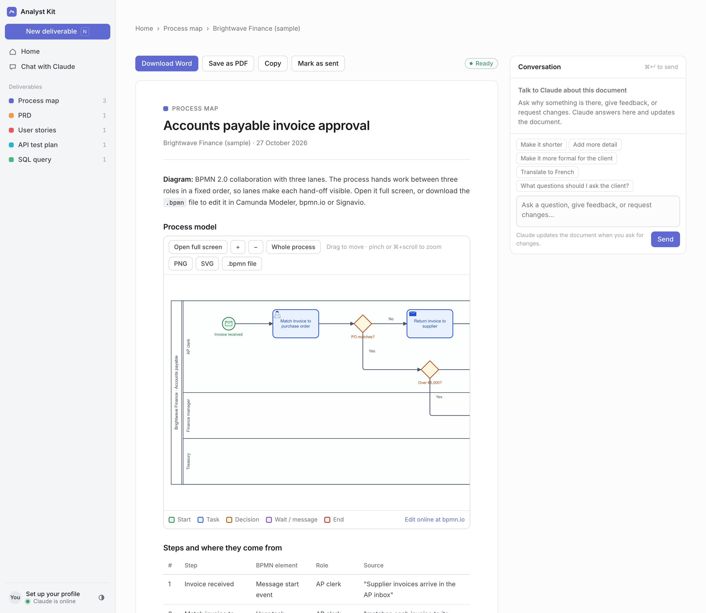
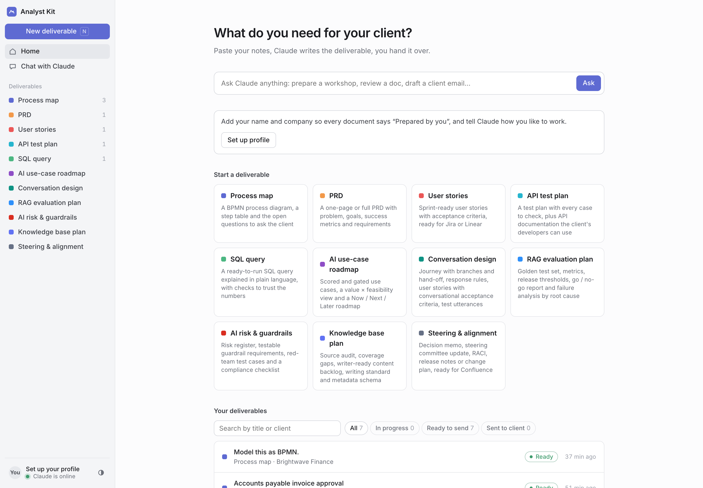
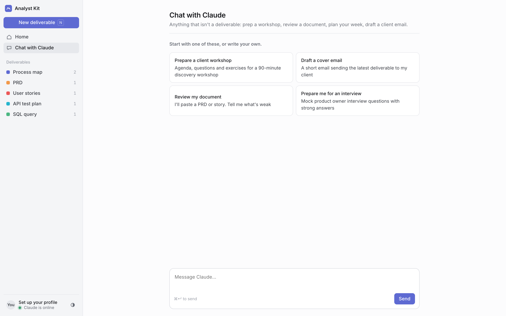

# AI Skills for Product Owners & Business Analysts

**Five AI skills that do the analysis work behind a product backlog, plus Analyst Kit, a local app that turns client notes into ready-to-send deliverables.**

I'm a Product Owner. I built this to answer one question: *what parts of my analysis work can an AI do to a professional standard, if I teach it the methods I actually use?* Each skill packages one industry method (BPMN 2.0, INVEST, Gherkin, MoSCoW, boundary value analysis…) as instructions Claude follows step by step. Every time, it returns a structured result that can be traced back to the source.



---

## What's inside

| | Skill | You give | You get | Methods |
|---|---|---|---|---|
| 1 | [**Process Modeler**](skills/modeling-processes/SKILL.md) | SOPs, meeting notes, policy text | Colour-coded BPMN 2.0 file with swimlanes (opens in Camunda, bpmn.io, Signavio), steps traced to the source, open questions for stakeholders | BPMN 2.0, *Method & Style*, UML |
| 2 | [**PRD Writer**](skills/writing-prds/SKILL.md) | A brief or an idea | One-pager or full PRD: problem with evidence, goals and non-goals, metrics with guardrails, traceable requirement IDs | Jobs to be done, MoSCoW, RAID, working backwards |
| 3 | [**User Stories & Acceptance Criteria**](skills/writing-user-stories/SKILL.md) | Requirements or a PRD section | Sprint-ready stories, Gherkin scenarios, INVEST check, Definition of Ready, Jira or Linear format | Story mapping, INVEST, SPIDR, Example Mapping, BDD |
| 4 | [**API Test & Documentation**](skills/testing-apis/SKILL.md) | Spec, curl calls or a description | Test matrix tied to business rules, runnable tests, OpenAPI 3.1, reference docs | Equivalence classes, boundary values, OWASP API Top 10, RFC 9457 |
| 5 | [**SQL Query Generator**](skills/generating-sql/SKILL.md) | A business question and a schema | Readable SQL with a plain-language walkthrough and validation queries | Metric/grain/filter framing, join fan-out and NULL guards |

The skills hand work to each other, so a single brief can follow a full delivery path:

```
PRD Writer ──► Process Modeler ──► User Stories ──► API Test & Docs ──► SQL (measure the success metrics)
```

## How each skill is built

Every skill follows the same five-part structure, so the AI works like a specialist rather than a general chatbot:

1. **Trigger:** a precise description of when the skill applies and when it doesn't.
2. **Role & method:** one expert stance and one named method.
3. **Guardrails:** ask about ambiguities, flag every assumption, never run destructive actions against production.
4. **Output contract:** fixed sections in a fixed order, ready to paste into Jira, Linear or Confluence.
5. **Quality gate:** a checklist the AI applies to its own answer before replying, plus a hand-off to the next skill.

This follows Anthropic's [Agent Skills](https://www.claude.com/blog/equipping-agents-for-the-real-world-with-agent-skills) format: plain `SKILL.md` files that Claude loads only when a request matches.

---

## Analyst Kit: the app

A minimal, Linear-style workspace for using the skills on real client work. No API key needed.

| Home | Chat |
|---|---|
|  |  |

- **Notes in, deliverable out.** Pick a deliverable, paste notes or drop a file, and get a client-ready document.
- **Conversation next to every document.** Ask questions or request changes. Claude replies in the thread and updates the document. Every earlier version is kept.
- **Professional process diagrams.** Real BPMN 2.0 drawn with bpmn-js (the engine behind Camunda): colour legend, swimlanes, zoom, full screen, and downloads as `.bpmn`, PNG or SVG. The layout comes from a script ([`build_bpmn.py`](skills/modeling-processes/scripts/build_bpmn.py)), not hand-written coordinates, so every diagram is consistent.
- **Client handover.** Export to Word (diagrams included) or PDF, or copy as formatted text. *Mark as sent* tracks what each client has received.
- **One-click next step.** Turn a PRD into user stories, or a process map into a PRD.
- **Learns how you work.** A profile sets your name on every document ("Prepared by…"), plus language, tone and backlog tool. Claude records preferences it picks up from your feedback.
- **Built small on purpose:** Python standard library and SQLite on the back end, plain JavaScript on the front end. Nothing to install.

### Run it

```bash
python3 app/server.py
# open http://localhost:4317
```

Requests wait in a local queue. Claude, running in a Claude Code session, picks them up with [`app/kit.py`](app/kit.py), writes the deliverable using the matching skill, and posts it back.

## Use the skills directly

- **Claude Code:** copy any folder from `skills/` into `~/.claude/skills/` (personal) or `.claude/skills/` in a repository (shared with your team).
- **claude.ai:** zip a skill folder and upload it under *Settings → Capabilities → Skills*.

Claude loads a skill automatically when your request matches its description.

## Repository layout

```
skills/   the five skills, one SKILL.md each
app/      Analyst Kit (server.py, kit.py, static/ front end, seed/ sample deliverables)
site/     one-page showcase of the skills (build.py embeds each SKILL.md)
docs/     screenshots
```

## References

[OMG BPMN 2.0.2](https://www.omg.org/spec/BPMN/2.0.2/) · Bruce Silver, *BPMN Method and Style* · Bill Wake, INVEST · Mike Cohn, SPIDR · Matt Wynne, Example Mapping · [Gherkin reference](https://cucumber.io/docs/gherkin/reference/) · [The Linear Method](https://linear.app/method) · [OpenAPI 3.1](https://spec.openapis.org/oas/v3.1.0) · [RFC 9457](https://www.rfc-editor.org/rfc/rfc9457) · [OWASP API Security Top 10](https://owasp.org/API-Security/)

All sample clients and figures in this repository are fictional.
