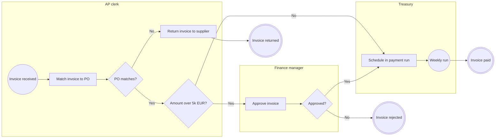

{"client": "Brightwave Finance (sample)", "skill": "modeling-processes", "title": "Accounts payable invoice approval", "input_tokens": 2140, "output_tokens": 1180, "seconds": 38}
===INPUT===
Model this as BPMN.

Supplier invoices arrive in the AP inbox. The AP clerk matches each invoice to its purchase order. If it doesn't match, it goes back to the supplier with a note. Matched invoices above €5,000 need sign-off from the finance manager. Approved invoices are scheduled by treasury in the next weekly payment run.
===OUTPUT===
**Diagram choice:** BPMN collaboration with lanes. The text describes hand-offs between three roles in a fixed order.

### Element inventory

| # | Element | Type | Lane | Source |
|---|---|---|---|---|
| 1 | Invoice received | Start (message) | AP clerk | "Supplier invoices arrive in the AP inbox" |
| 2 | Match invoice to PO | Task | AP clerk | "matches each invoice to its purchase order" |
| 3 | PO matches? | Exclusive gateway | AP clerk | "If it doesn't match" |
| 4 | Return invoice to supplier | Task | AP clerk | "goes back to the supplier with a note" |
| 5 | Amount over €5,000? | Exclusive gateway | AP clerk | "Matched invoices above €5,000" |
| 6 | Approve invoice | Task | Finance manager | "need sign-off from the finance manager" |
| 7 | Schedule in payment run | Task | Treasury | "scheduled by treasury in the next weekly payment run" |
| 8 | Wait for weekly run | Timer event | Treasury | "next weekly payment run" |
| 9 | Invoice rejected by manager | End | Finance manager | **A** — not in source |

### Model

### Open questions

1. **Step 6:** What happens when the finance manager rejects an invoice? Is it returned to the supplier or cancelled? (modelled as an assumed end event)
2. **Step 6:** Is there an approval deadline, and who is alerted if it is missed?
3. **Step 5:** Is the €5,000 threshold before or after VAT?
4. **Step 4:** Does the returned invoice re-enter the flow when the supplier corrects it?

### Improvement notes

- Three-way match (PO, goods receipt, invoice) is missing; without it the company may pay for goods never received.
- A weekly run delays payments up to 7 days; check early-payment discounts lost.
