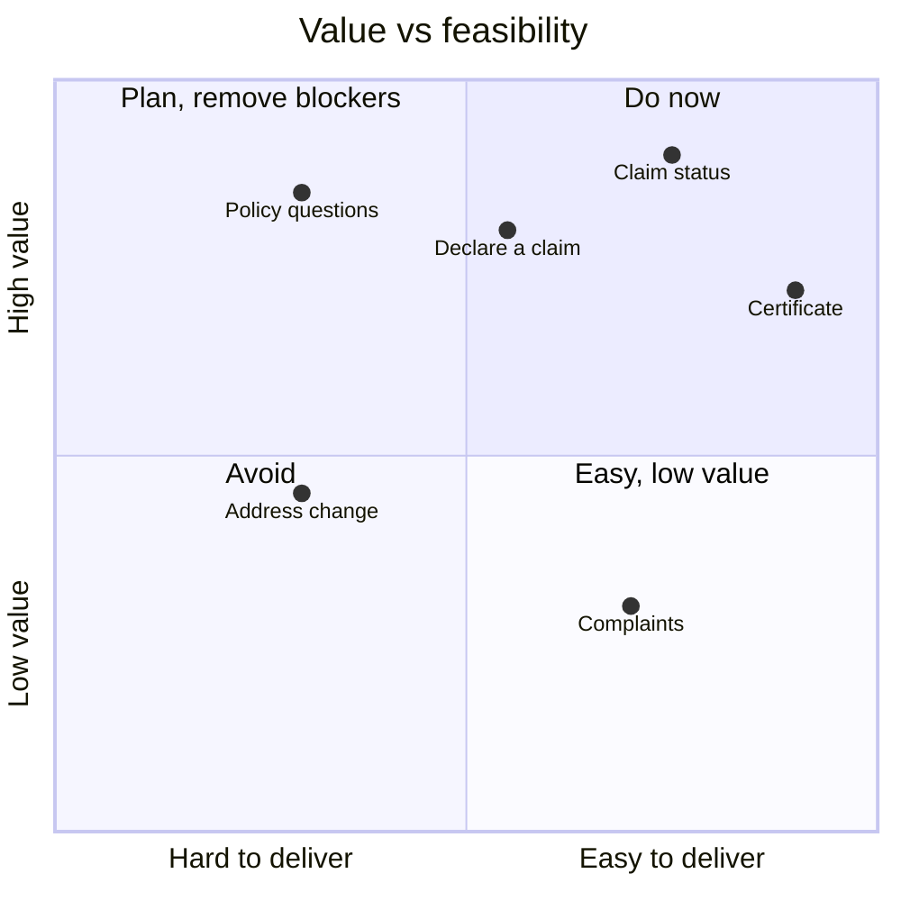

{"client": "Harbor Mutual (sample)", "skill": "prioritizing-ai-use-cases", "title": "Customer assistant roadmap: home & motor insurance"}
===INPUT===
We're adding a generative AI assistant to our customer app and website (home and motor insurance, 1.2M customers). Budget for two use cases per quarter. Candidates from the contact centre (monthly volumes):

- Claim status ("where is my claim?") 22k. Status is in the claims system, API exists
- Declare a claim (first notice of loss) 9k. Form exists but 40% abandon it
- Policy questions ("am I covered for…?") 15k. Answers in policy PDFs, 14 versions in force
- Download a certificate (green card, home certificate) 11k. Self-service exists but people can't find it
- Change of address / vehicle 6k. Changes the premium
- Complaints 2k. Regulated process, must reach a human within 48h

Constraints: no coverage decisions by the AI, compliance wants a human on complaints. Contact centre cost is about 6€ per call.
===OUTPUT===
### 1 · Assumptions and data gaps

| # | Assumption | Confirm with |
|---|---|---|
| A1 | Volumes are monthly contacts across phone and email, not unique customers | Contact centre lead |
| A2 | The claims status API returns status *and* the next step in plain words | Claims IT |
| A3 | Policy PDFs can be split per product version and tagged with `product`, `version`, `valid_from` | Product & legal |
| A4 | "Coverage decision" means any answer stating a specific loss *is* or *is not* covered | Compliance |

### 2 · Use-case inventory

| ID | Use case | Volume / month | Where the answer lives | Type |
|---|---|---|---|---|
| UC-1 | Claim status | 22,000 | Claims system (API) | Data lookup + explanation |
| UC-2 | Policy questions | 15,000 | 14 policy PDFs | RAG on documents |
| UC-3 | Download a certificate | 11,000 | Self-service page | Navigation |
| UC-4 | Declare a claim (FNOL) | 9,000 | Online form | Guided form filling |
| UC-5 | Change of address / vehicle | 6,000 | Policy admin system | Transaction, affects premium |
| UC-6 | Complaints | 2,000 | Complaints process | Regulated hand-off |

### 3 · Scoring (1 to 5) · weights: value 30% · impact 20% · knowledge 20% · feasibility 15% · risk (inverted) 15%

| Use case | Value | Impact | Knowledge | Feasibility | Risk (5 = low) | **Score** | Risk gate | Knowledge gate |
|---|---|---|---|---|---|---|---|---|
| UC-1 Claim status | 5 | 5 | 4 | 4 | 4 | **4.5** | ✓ | ✓ |
| UC-3 Certificate | 4 | 4 | 5 | 5 | 5 | **4.5** | ✓ | ✓ |
| UC-4 Declare a claim | 5 | 4 | 4 | 3 | 3 | **4.0** | ✓ human review of every claim | ✓ |
| UC-2 Policy questions | 5 | 4 | 2 | 3 | 2 | **3.5** | ✗ coverage-decision risk | ✗ 14 versions, no metadata |
| UC-5 Address / vehicle | 3 | 3 | 4 | 2 | 2 | **2.9** | ✗ changes premium | ✓ |
| UC-6 Complaints | 3 | 2 | 3 | 4 | 1 | **2.7** | ✗ regulated | ✓ |

> Business impact estimate: if UC-1 and UC-3 resolve 50% of contacts without an agent, that is ~16,500 calls avoided per month, about **99k€ per month** at 6€ per call (to validate with Finance).

### 4 · Value × feasibility

### 5 · Roadmap

| | Use cases | Outcome goal (measured 8 weeks after launch) | Enablers |
|---|---|---|---|
| **Now · Q1** | UC-1 Claim status, UC-3 Certificate | 50% resolved without an agent · CSAT ≥ 4/5 · repeat contact within 72h < 15% | Claims API in plain words, deep links to certificate pages, golden test set |
| **Next · Q2** | UC-4 Declare a claim | Form abandonment from 40% to 20% · every declaration reviewed by a claims handler | Form pre-fill from conversation, photo upload |
| **Later · Q3+** | UC-2 Policy questions (information only, never "you are covered") | 30% of policy calls deflected, zero coverage decisions in review sample | One page per product version with metadata, approved refusal message, legal sign-off |
| **Route, don't automate** | UC-5 Address change, UC-6 Complaints | Complaint reaches a human in < 1h (target), < 48h (rule) | Assistant recognises intent and hands off with context |

### 6 · Trade-offs for the steering committee

- **Not now: policy questions**, although value is high. The 14 PDF versions have no metadata, so the assistant could quote the wrong contract. Fix the content first (see *Knowledge base plan*).
- **Never automated: complaints.** The assistant only detects them and hands off. This is a compliance requirement, not a technical limit.
- **Decision needed:** approve 3 weeks of Claims IT time to make the status API return plain-language next steps. Without it, UC-1 gives statuses customers don't understand ("CLM-04 pending expert").

**Next step:** design the *Claim status* conversation, including the hand-off when a claim is delayed.
